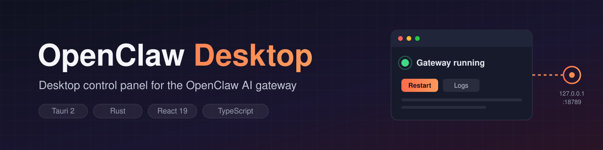
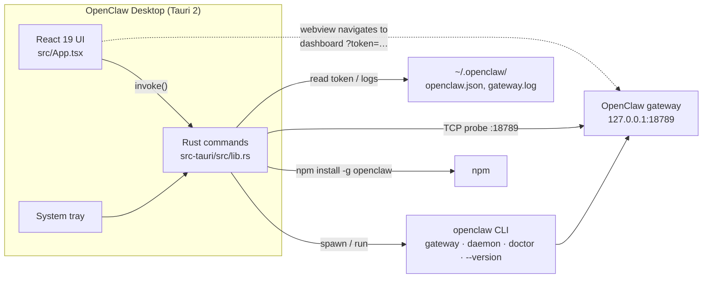

<p align="center">
  
</p>

<p align="center">
  <strong>Desktop control panel for the <a href="https://github.com/openclaw/openclaw">OpenClaw</a> AI gateway</strong>
</p>

<p align="center">
  <a href="LICENSE"></a>
  
  <a href="https://github.com/muhib-karim/openclaw-desktop/actions/workflows/ci.yml"></a>
  <a href="https://github.com/muhib-karim/openclaw-desktop/releases"></a>
</p>

---

## What it is

**OpenClaw Desktop** is a small native desktop app (Tauri 2 + Rust + React) that wraps the
[OpenClaw](https://github.com/openclaw/openclaw) command-line AI assistant. OpenClaw runs a local
HTTP gateway with a web dashboard; on Windows it's usually driven from a terminal or WSL2. This app
gives it a windowed UI and a system-tray icon: it checks whether OpenClaw is installed, starts the
gateway, shows its status and logs, and then opens the gateway's own dashboard inside the app
window.

The app doesn't reimplement OpenClaw. It runs the `openclaw` CLI and talks to the gateway on
`127.0.0.1:18789`.

## Key features

All of these are implemented in [`src-tauri/src/lib.rs`](src-tauri/src/lib.rs) and
[`src/App.tsx`](src/App.tsx):

| Feature | How it works |
|---------|--------------|
| **Setup wizard** | Checks whether `openclaw` is on `PATH` (`where` / `which`). If it isn't, offers to run `npm install -g openclaw` |
| **Gateway auto-start** | When the app launches, it starts `openclaw gateway --port 18789 --verbose` in the background if the port isn't already in use |
| **Live status** | Probes the gateway port with a TCP connect every 3 s and shows Running / Starting / Stopped |
| **Start / restart / stop** | Start spawns the gateway directly. Restart and Stop run `openclaw daemon restart` / `openclaw daemon stop` |
| **Embedded dashboard** | When the gateway is up, the window navigates to the gateway dashboard. The auth token comes from `~/.openclaw/openclaw.json`, with the legacy path `~/.clawdbot/clawdbot.json` as a fallback |
| **Open in browser** | Opens the same tokenized dashboard URL in your default browser |
| **Log panel** | Shows the last 200 lines of `~/.openclaw/gateway.log`, refreshed every second |
| **Diagnostics** | Shows the installed OpenClaw version and whether the gateway is running, and runs `openclaw doctor` from the UI |
| **System tray** | Closing the window hides it to the tray. The tray menu has Start, Stop, Open and Quit |
| **Single instance** | Launching the app a second time focuses the existing window instead of opening another |

## Screenshots

There are no screenshots in the repository yet.

## Install

Pre-built installers are published on the
[Releases page](https://github.com/muhib-karim/openclaw-desktop/releases). The CI workflow builds
them for Windows (`.msi` / `.exe`), macOS (`.dmg`, Intel and Apple Silicon) and Linux (`.AppImage`,
`.deb`, `.rpm`). Not every release has every platform; for example, the v0.1.0 release has no
Windows assets attached.

**Runtime requirement:** to install the `openclaw` CLI, you need either OpenClaw itself or Node.js +
npm so the setup wizard can install it.

## Quick start (from source)

Prerequisites: Node.js 18+ (CI uses 20), [pnpm](https://pnpm.io/) 10, the stable
[Rust toolchain](https://rustup.rs/), and the
[Tauri system dependencies](https://v2.tauri.app/start/prerequisites/) for your OS.

```bash
git clone https://github.com/muhib-karim/openclaw-desktop.git
cd openclaw-desktop
pnpm install

pnpm tauri dev      # run the desktop app with hot reload
pnpm tauri build    # produce installers for the current platform
```

Frontend-only commands (no Rust needed):

```bash
pnpm dev            # Vite dev server on http://localhost:1420
pnpm build          # tsc + vite build into dist/
pnpm test           # Vitest unit tests
```

## Usage

1. Launch **OpenClaw Desktop**.
2. If OpenClaw isn't installed, click **Install OpenClaw**. This runs `npm install -g openclaw`.
3. The app starts the gateway on port `18789`. Once the port responds, the window switches to the
   OpenClaw dashboard.
4. Use **📋 Logs** to see the gateway log and diagnostics, or to run `openclaw doctor`. Use
   **🔄 Restart** to restart the gateway and **🔗** to open the dashboard in a browser.
5. Closing the window hides it to the system tray. Choose **Quit** from the tray menu to exit.

Gateway logs are written to `~/.openclaw/gateway.log` and `~/.openclaw/gateway_error.log`.

## Architecture



- **Frontend (`src/`)**: React 19 + TypeScript, built with Vite. Pure UI helpers live in
  `src/lib/gateway.ts`.
- **Backend (`src-tauri/src/lib.rs`)**: 13 `#[tauri::command]` functions that handle status,
  start/stop/restart, install, logs, diagnostics, doctor and dashboard navigation. Also contains
  the tray menu and the window lifecycle (close hides to tray).
- **Security**: the Tauri CSP limits network, frame and websocket access to `self` and
  `127.0.0.1`.

## Testing

| Layer | Command | What it covers |
|-------|---------|----------------|
| Frontend | `pnpm test` | 9 Vitest unit tests for the gateway state, status labels, doctor output formatting and the install label |
| Frontend | `pnpm exec tsc --noEmit` / `pnpm build` | Strict TypeScript typecheck and production bundle |
| Rust | `cd src-tauri && cargo test` | 10 unit tests for config token parsing, dashboard URL building/encoding and log tailing |
| Rust | `cd src-tauri && cargo fmt --all -- --check` | Formatting |
| Rust | `cd src-tauri && cargo clippy --all-targets --all-features -- -D warnings` | Lints |

All of these run in GitHub Actions on every push and pull request
([`.github/workflows/ci.yml`](.github/workflows/ci.yml)). The Rust job installs the documented
Tauri apt dependencies on `ubuntu-22.04`. A separate tag-triggered workflow
([`build.yml`](.github/workflows/build.yml)) builds the release installers for Windows, macOS and
Linux.

## Project structure

```
openclaw-desktop/
├── src/                     # React + TypeScript frontend
│   ├── App.tsx              # Setup wizard, status bar, log panel
│   ├── lib/gateway.ts       # Pure UI helpers (+ gateway.test.ts)
│   └── App.css, index.css
├── src-tauri/               # Rust / Tauri backend
│   ├── src/lib.rs           # Tauri commands, tray, window lifecycle, unit tests
│   ├── src/main.rs          # Entry point
│   ├── tauri.conf.json      # Window, CSP and bundle config
│   └── capabilities/        # Tauri permission capabilities
├── docs/banner.svg
└── .github/workflows/       # ci.yml (checks) and build.yml (release builds)
```

## Compatibility

The app talks to the OpenClaw gateway over HTTP on port `18789`. It should work with any OpenClaw
version whose CLI provides `gateway`, `daemon` and `doctor`. Earlier releases list these versions:

| OpenClaw version | Desktop app version |
|------------------|---------------------|
| 2026.2.x | v0.0.2+ |
| 2026.1.x | v0.0.1+ |

## Limitations and roadmap

- **Stop vs. start:** the app starts the gateway as a child process, but Stop and Restart call
  `openclaw daemon stop|restart`. If the gateway isn't running as an OpenClaw daemon, those
  commands may not affect it.
- The tray menu's status line is set once at startup and isn't refreshed live.
- The gateway port is fixed at `18789`.
- Ideas: a configurable port, a live tray status, and screenshots in this README.

## Support

If you find this project useful, you can support development on
[Ko-fi](https://ko-fi.com/ai_dev_2024).

## License

[MIT](LICENSE)
