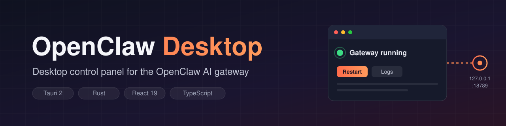
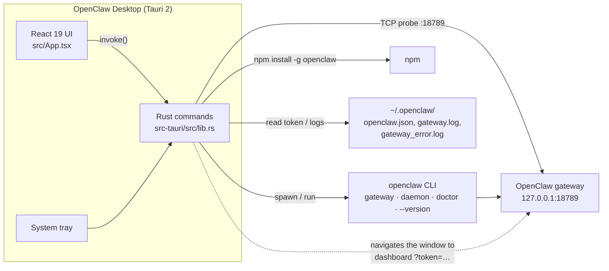

<p align="center">
  
</p>

<p align="center">
  <strong>Desktop control panel for the <a href="https://github.com/openclaw/openclaw">OpenClaw</a> AI gateway</strong>
</p>

<p align="center">
  <a href="https://github.com/muhib-karim/openclaw-desktop/actions/workflows/ci.yml"></a>
  <a href="LICENSE"></a>
</p>

---

## What it is

**OpenClaw Desktop** is a small native desktop app (Tauri 2 + Rust + React) that wraps the
[OpenClaw](https://github.com/openclaw/openclaw) command-line AI assistant. OpenClaw runs a local
HTTP gateway with a web dashboard; on Windows it's usually driven from a terminal or WSL2. This app
gives it a windowed UI and a system-tray icon: it checks whether OpenClaw is installed, starts the
gateway, shows its status and logs, and then opens the gateway's own dashboard inside the app
window.

## Why it matters

Running OpenClaw normally means keeping a terminal open, remembering CLI commands and finding the
dashboard URL and token yourself. The app turns that into one window: install, start, check status,
read logs and open the dashboard without leaving it. It doesn't reimplement OpenClaw; it runs the
`openclaw` CLI and talks to the gateway on `127.0.0.1:18789`.

## Key features

All of these are implemented in [`src-tauri/src/lib.rs`](src-tauri/src/lib.rs) and
[`src/App.tsx`](src/App.tsx):

| Feature | How it works |
|---------|--------------|
| **Setup wizard** | Checks whether `openclaw` is on `PATH` (`where` / `which`). If it isn't, offers to run `npm install -g openclaw`. On macOS and Linux the usual Node locations (Homebrew, nvm, volta, `~/.npm-global`, ...) are added to `PATH` first, because apps started from Finder or a launcher don't inherit the shell's `PATH` |
| **Gateway auto-start** | When the app launches, it starts `openclaw gateway --port 18789 --verbose` in the background if the port isn't already in use. A second start while one is still coming up is ignored |
| **Live status** | Probes the gateway port with a TCP connect (500 ms timeout) every 3 s and shows Running / Starting / Stopped. A start that hasn't opened the port after 30 s is reported as failed |
| **Start / restart / stop** | Start spawns the gateway directly. Restart and Stop run `openclaw daemon restart` / `openclaw daemon stop` |
| **Embedded dashboard** | When the gateway is up, the window navigates to the gateway dashboard. The auth token comes from `~/.openclaw/openclaw.json`, with the legacy path `~/.clawdbot/clawdbot.json` as a fallback |
| **Open in browser** | Opens the same tokenized dashboard URL in your default browser. The backend builds and opens it; the UI never sees the token |
| **Log panel** | Shows the last 200 lines of `~/.openclaw/gateway.log`, followed by `gateway_error.log` when it has content, refreshed every second |
| **Diagnostics** | Shows the installed OpenClaw version and whether the gateway is running, and runs `openclaw doctor` from the UI |
| **System tray** | Closing the window hides it to the tray. The tray menu shows the live gateway status and has Start, Stop, Open and Quit |
| **Single instance** | Launching the app a second time focuses the existing window instead of opening another |

## Install

Pre-built installers are published on the
[Releases page](https://github.com/muhib-karim/openclaw-desktop/releases). The CI workflow builds
them for Windows (`.msi` / `.exe`), macOS (`.dmg`, Intel and Apple Silicon) and Linux (`.AppImage`,
`.deb`, `.rpm`). Not every release has every platform; for example, the v0.1.0 release has no
Windows assets attached.

**Runtime requirement:** the `openclaw` CLI must already be installed, or Node.js + npm must be
available so the setup wizard can install it.

The installers are not code-signed or notarized, so Windows SmartScreen and macOS Gatekeeper will
warn on first launch.

## Quick start (from source)

Prerequisites:

- Node.js 22 LTS (22.22 or newer; CI uses 22)
- [pnpm](https://pnpm.io/) 10. The exact version is pinned in `package.json` (`packageManager`),
  so `corepack enable` is enough
- The stable [Rust toolchain](https://rustup.rs/)
- The [Tauri system dependencies](https://v2.tauri.app/start/prerequisites/) for your OS

```bash
git clone https://github.com/muhib-karim/openclaw-desktop.git
cd openclaw-desktop
pnpm install

pnpm tauri dev      # run the desktop app with hot reload
pnpm tauri build    # produce installers for the current platform
```

Checks (the same ones CI runs):

```bash
pnpm lint                 # ESLint (type-checked rules + React hooks)
pnpm exec tsc --noEmit    # strict typecheck
pnpm test                 # Vitest unit and component tests
pnpm build                # tsc + vite build into dist/

cd src-tauri              # Rust; needs `pnpm build` first so ../dist exists
cargo fmt --all -- --check
cargo clippy --all-targets --all-features -- -D warnings
cargo test
```

pnpm is the only supported package manager; `pnpm-lock.yaml` is the only lockfile.

## Usage

1. Launch **OpenClaw Desktop**.
2. If OpenClaw isn't installed, click **Install OpenClaw**. This runs `npm install -g openclaw`.
3. The app starts the gateway on port `18789`. Once the port responds, the window switches to the
   OpenClaw dashboard.
4. Use **📋 Logs** to see the gateway log and diagnostics, or to run `openclaw doctor`. Use
   **🔄 Restart** to restart the gateway and **🔗** to open the dashboard in a browser. Problems
   (a failed start, a start that times out, a failed install check) are shown in the window
   rather than only in the console.
5. Closing the window hides it to the system tray. Choose **Quit** from the tray menu to exit.

Gateway logs are written to `~/.openclaw/gateway.log` and `~/.openclaw/gateway_error.log`.

## Architecture



- **Frontend (`src/`)**: React 19 + TypeScript, built with Vite. Pure UI helpers live in
  `src/lib/gateway.ts`.
- **Backend (`src-tauri/src/lib.rs`)**: 13 `#[tauri::command]` functions that handle status,
  start/stop/restart, install, logs, diagnostics, doctor and dashboard navigation. Anything that
  spawns a process or touches a socket or file runs on a blocking thread pool, never on the UI
  thread. Also contains the tray menu, a small background thread that keeps the tray status
  current, and the window lifecycle (close hides to tray).
- **Security**: see [Security notes](#security-notes).

## Security notes

**What the app executes.** Only these commands, always with fixed arguments: `openclaw gateway
--port 18789 --verbose`, `openclaw daemon stop|restart`, `openclaw doctor`, `openclaw --version`,
`where`/`which openclaw`, and `npm install -g openclaw` (only when you click **Install
OpenClaw**). Nothing typed into the UI or received from the network is passed to a shell.

**Network.** The app only talks to `127.0.0.1:18789`. "Running" means a TCP connection to that
port succeeded; the app does not verify that the listener is really the OpenClaw gateway.

**Gateway token.** The token is read from `~/.openclaw/openclaw.json` (`gateway.auth.token`) each
time the dashboard is opened. The app does not store or log it, and the React UI never receives
it. It is sent to the gateway as a `?token=` query parameter when the window navigates to the
dashboard and when you choose **Open in browser** (where it ends up in that browser's history).

**Webview permissions.** The capability file grants `core:default` only, with no remote origins,
so Tauri plugin APIs are not available to the embedded dashboard page. The CSP for the app's own
pages allows scripts from the bundle only (no inline script) and connections to the app and its
IPC endpoint only. One gap remains: the app's own commands are not yet restricted to the app's
origin, so the dashboard page loaded in the window can call them (start/stop/restart, doctor,
install, read logs). None of them takes free-form input. See
[Limitations](#limitations-and-roadmap).

**Files.** Gateway output goes to `~/.openclaw/gateway.log` and `gateway_error.log`. Verbose
output can contain request URLs, so on macOS and Linux both files are created with mode `0600`,
and `~/.openclaw` with `0700` when this app is the one creating it.

**Supply chain.** CI pins every GitHub Action to a commit SHA, installs from the frozen lockfile,
audits runtime dependencies and scans the full history with gitleaks. Dependabot proposes updates
weekly. Release installers are built by CI but are not signed.

**Reporting.** Please report vulnerabilities privately (GitHub's "Report a vulnerability" on this
repository's Security tab, or by contacting the maintainer) rather than in a public issue.

## Testing

| Layer | Command | What it covers |
|-------|---------|----------------|
| Frontend | `pnpm test` | Vitest. Unit tests for the helpers in `src/lib/gateway.ts`, and component tests for `App.tsx` (jsdom, mocked `invoke`): install-check failure and retry, doctor output surviving a log refresh, failed and repeated dashboard navigation, failed start, start timeout |
| Frontend | `pnpm lint` | ESLint with type-checked rules (floating promises) and the React hooks rules |
| Frontend | `pnpm exec tsc --noEmit` / `pnpm build` | Strict TypeScript typecheck and production bundle |
| Rust | `cd src-tauri && cargo test` | Unit tests for token parsing, dashboard URL building, log tailing, the port probe, command construction per OS, `PATH` merging, child-process tracking and log file handling |
| Rust | `cd src-tauri && cargo fmt --all -- --check` | Formatting |
| Rust | `cd src-tauri && cargo clippy --all-targets --all-features -- -D warnings` | Lints |

All of these run in GitHub Actions on every push to `master` and every pull request
([`.github/workflows/ci.yml`](.github/workflows/ci.yml)). The Rust job runs on `ubuntu-22.04` and
`windows-latest`, so the Windows-only code paths are compiled and tested too; a third job scans
the history for secrets. A separate tag-triggered workflow
([`build.yml`](.github/workflows/build.yml)) builds the release installers for Windows, macOS and
Linux.

## Project structure

```
openclaw-desktop/
├── src/                     # React + TypeScript frontend
│   ├── App.tsx              # Setup wizard, status bar, log panel (+ App.test.tsx)
│   ├── lib/gateway.ts       # Pure UI helpers (+ gateway.test.ts)
│   └── App.css, index.css
├── src-tauri/               # Rust / Tauri backend
│   ├── src/lib.rs           # Tauri commands, tray, window lifecycle, unit tests
│   ├── src/main.rs          # Entry point
│   ├── tauri.conf.json      # Window, CSP and bundle config
│   └── capabilities/        # Tauri permission capabilities
├── docs/banner.svg
├── eslint.config.js
└── .github/                 # workflows/ci.yml (checks), workflows/build.yml (release builds),
                             # dependabot.yml
```

## Compatibility

The app talks to the OpenClaw gateway over HTTP on port `18789`. It should work with any OpenClaw
version whose CLI provides `gateway`, `daemon` and `doctor`. Previously documented pairings (not
re-tested against current OpenClaw releases):

| OpenClaw version | Desktop app version |
|------------------|---------------------|
| 2026.2.x | v0.0.2+ |
| 2026.1.x | v0.0.1+ |

## Limitations and roadmap

- **Stop vs. start:** the app starts the gateway as a child process, but Stop and Restart call
  `openclaw daemon stop|restart`. If the gateway isn't running as an OpenClaw service, those
  commands may not affect it. Quitting the app also leaves a gateway it started running.
- **No way back from the dashboard:** once the window has navigated to the dashboard, the app's
  own screen is gone. If the gateway stops later, use the tray (it shows the live status and can
  start the gateway again) or relaunch the app.
- **App commands are not origin-restricted** (see [Security notes](#security-notes)). The fix is
  an app ACL manifest in `build.rs` plus matching permissions; it needs testing in a running app.
- The token is sent as `?token=`; newer OpenClaw versions prefer `#token=`.
- `openclaw.json` is read as strict JSON, from the default location only. A config with JSON5
  comments, a relocated state directory (`OPENCLAW_PROFILE`, `OPENCLAW_STATE_DIR`,
  `OPENCLAW_CONFIG_PATH`) or a token supplied through the environment means the dashboard opens
  without a token.
- `PATH` detection covers the common Node install locations. With asdf, mise or a custom npm
  prefix, start the app from a terminal.
- On macOS, clicking the Dock icon does not bring back a hidden window; use the tray icon.
- The gateway port is fixed at `18789`.
- The macOS-specific Rust code is only compiled by the release workflow; CI covers Linux and
  Windows.
- Ideas: a configurable port, signed installers, and screenshots in this README.

## Tech stack

- **Language:** Rust
- **Frameworks and tools:** React, Tauri, Vite, TypeScript, Vitest, ESLint, Rust (Cargo)
- **CI:** GitHub Actions, gitleaks, Dependabot

## Contributing

Issues and pull requests are welcome. Before opening a pull request, run `pnpm lint`, `pnpm test`
and, in `src-tauri/`, `cargo fmt --all -- --check` and `cargo test`. Please keep each pull request
focused and say how you tested it.

## License

[MIT](LICENSE)
